# Lareon OS setup flow

**Rule: nobody sees the desktop until setup is finished.**

From the USB stick to the first desktop, every screen is full screen: no
panel, no desktop, no other apps. This is the design for roadmap stage 2
([ROADMAP.md](../ROADMAP.md)). The pictures in `setup-flow/` are mockups
(not built yet), made with the real Lareon logos, Geist fonts, colours and
wallpaper.

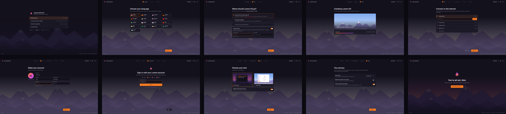

---

## Part 1: from the USB stick

### 1. Boot menu
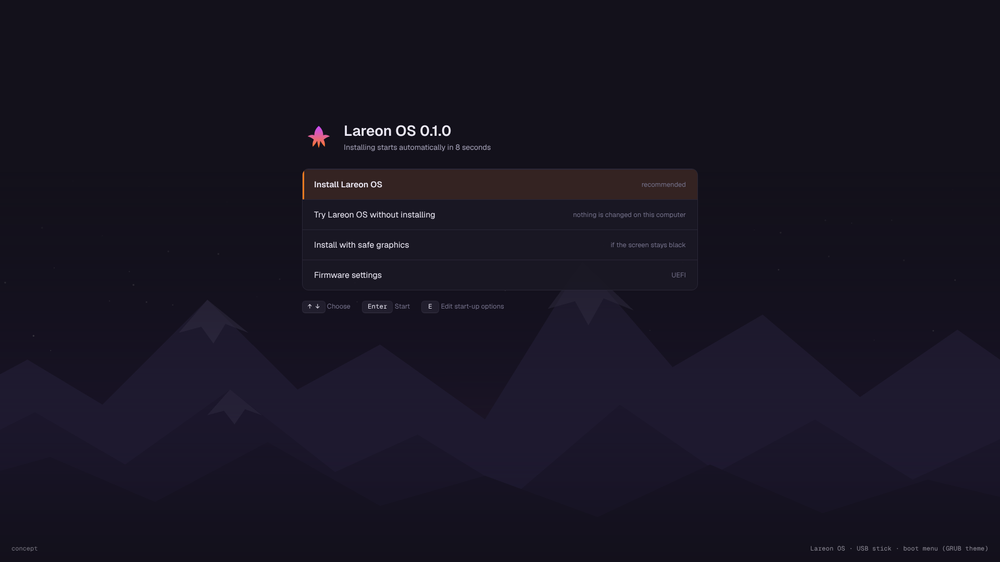

| Choice | What it does |
|---|---|
| **Install Lareon OS** (default) | Full-screen installer. Starts by itself after 8 seconds. |
| Try Lareon OS without installing | Today's live desktop, to check Wi-Fi, sound and the screen first. Nothing on the computer changes. |
| Install with safe graphics | Same installer, for computers whose screen stays black. |
| Firmware settings | Opens the computer's UEFI settings. |

Keep "Try": without it, someone with unsupported hardware only finds out after
the drive is wiped.

### 2. Language (installer step 1 of 3)
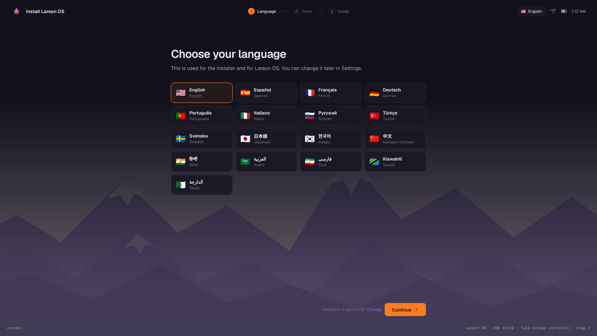

- The 17 languages from [LANGUAGES.md](LANGUAGES.md), each with its flag,
  shown in its own name (e.g. Deutsch, 日本語, العربية) with the English name below.
- Darija uses the Algerian flag. Arabic, Farsi and Darija lay the screens out
  right to left.
- Other flags in the mockup are placeholders until matched to the Lareon app.
- Keyboard layout follows the language, with a "Change" link.
- The choice carries over to the installed system.

### 3. Drive (installer step 2 of 3)
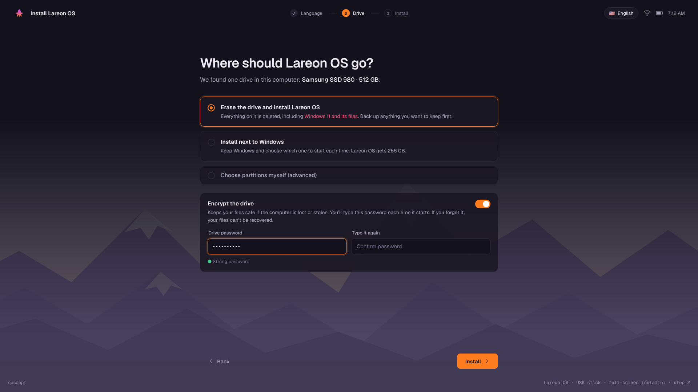

- Says which drive was found, in plain words (model and size).
- **Erase the drive and install Lareon OS**: warns in red if another system
  (e.g. Windows) and its files will be deleted.
- **Install next to Windows**: keep both and choose at each start.
- **Choose partitions myself (advanced)**: Calamares' manual partitioning.
- **Encrypt the drive**, with its password twice and a strength hint. Explains
  that the password is needed at every start and can't be recovered.
- The button says **Install**, not "Next", because this is the point of no return.

### 4. Installing (installer step 3 of 3)
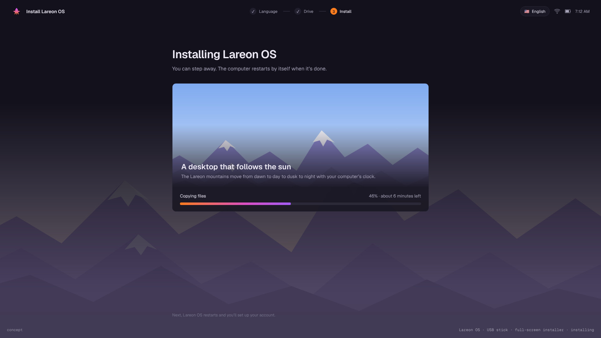

- Lareon slideshow (the time-of-day scene) with one line about Lareon OS.
- Progress bar in the brand gradient, current task and time left.
- "You can step away. The computer restarts by itself when it's done."
- No user account is made here (Calamares "OEM" mode). That happens on the
  first start.

---

## Part 2: first start, before the desktop exists

After the restart, the computer opens Lareon setup instead of the sign-in
screen. It runs once.

### 5. Wi-Fi (setup step 1 of 5)
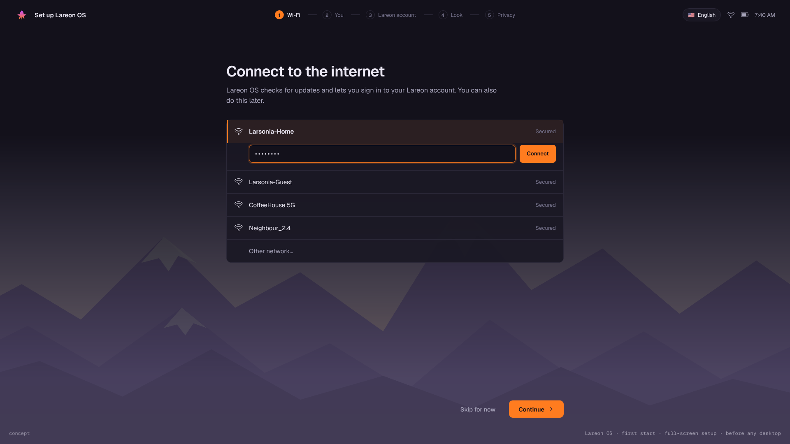

- Nearby networks; choosing one opens its password field inline.
- **Skip for now** is always available. Setup works offline; only Lareon
  account sign-in needs a connection.

### 6. Your account (setup step 2 of 5)
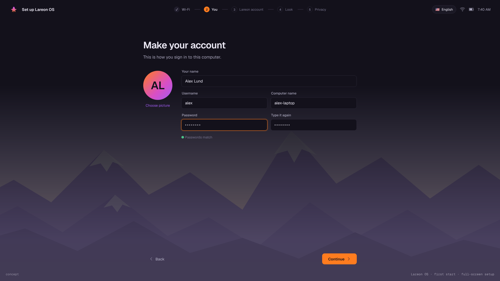

- Your name, username (filled in from the name), computer name, password twice.
- Picture: initials in the brand gradient by default, or choose one.

### 7. Lareon account (setup step 3 of 5)
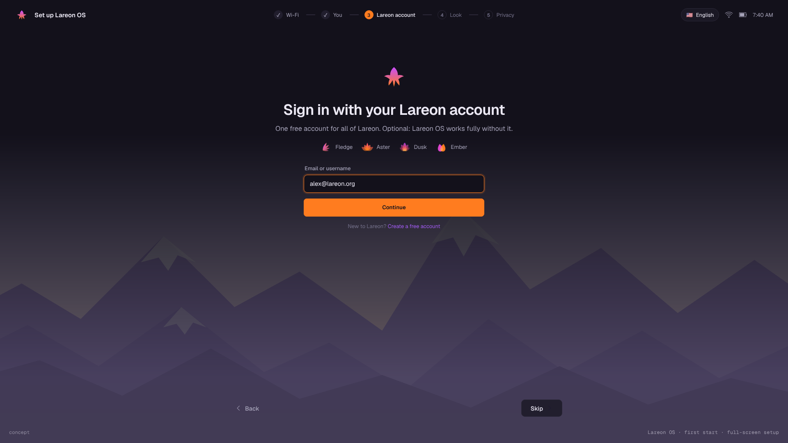

- Sign in with a Lareon account, with the Fledge, Aster, Dusk and Ember marks
  to show what it unlocks.
- **Create a free account** link, and **Skip**. Says plainly that Lareon OS
  works fully without an account.
- Done here rather than in the installer: the user is online, and the sign-in
  goes straight into their own account.

### 8. Look (setup step 4 of 5)
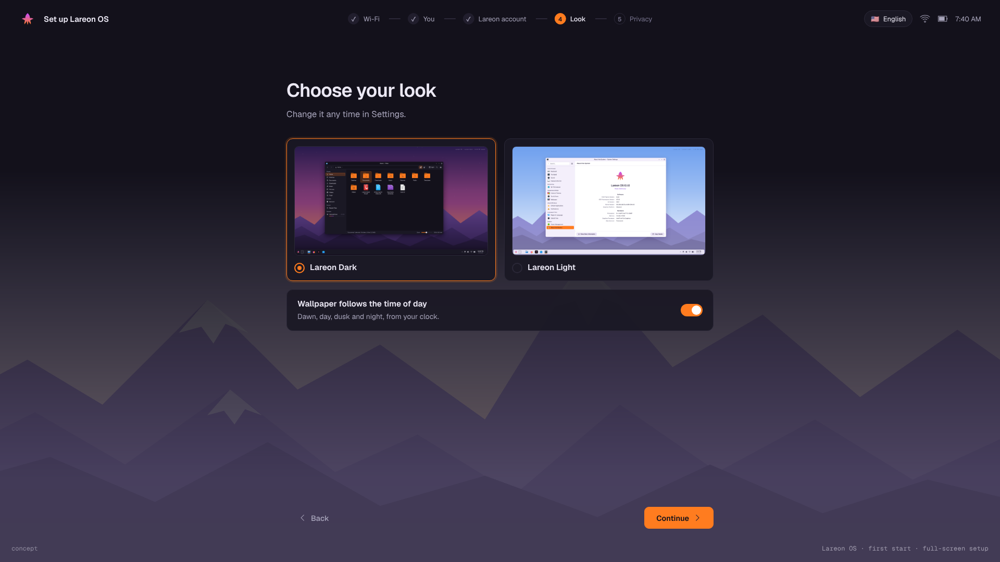

- Lareon Dark (default) or Lareon Light, shown as real desktop previews.
- "Wallpaper follows the time of day" switch (on by default).

### 9. Privacy (setup step 5 of 5)
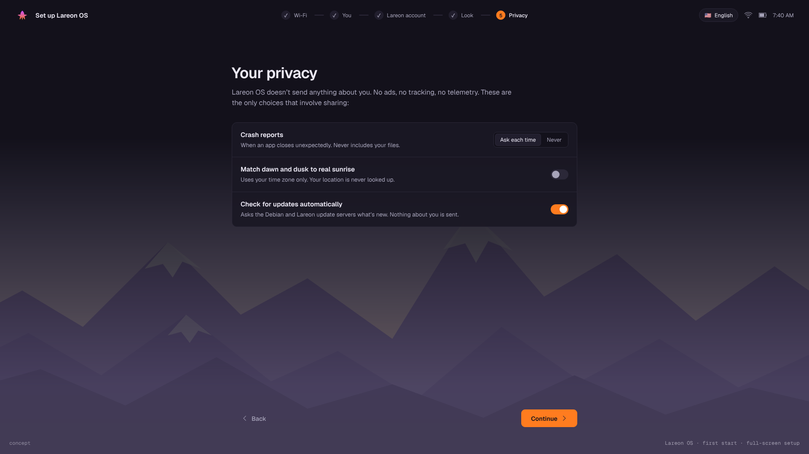

- Opens with the promise: nothing about you is sent; no ads, tracking or telemetry.
- Only three choices, each saying what it shares:
  - **Crash reports**: Ask each time (default) / Never. Never includes files.
  - **Match dawn and dusk to real sunrise**: off by default. Uses the time zone
    only; location is never looked up.
  - **Check for updates automatically**: on. Asks the update servers what's
    new; sends nothing about you.

### 10. All set
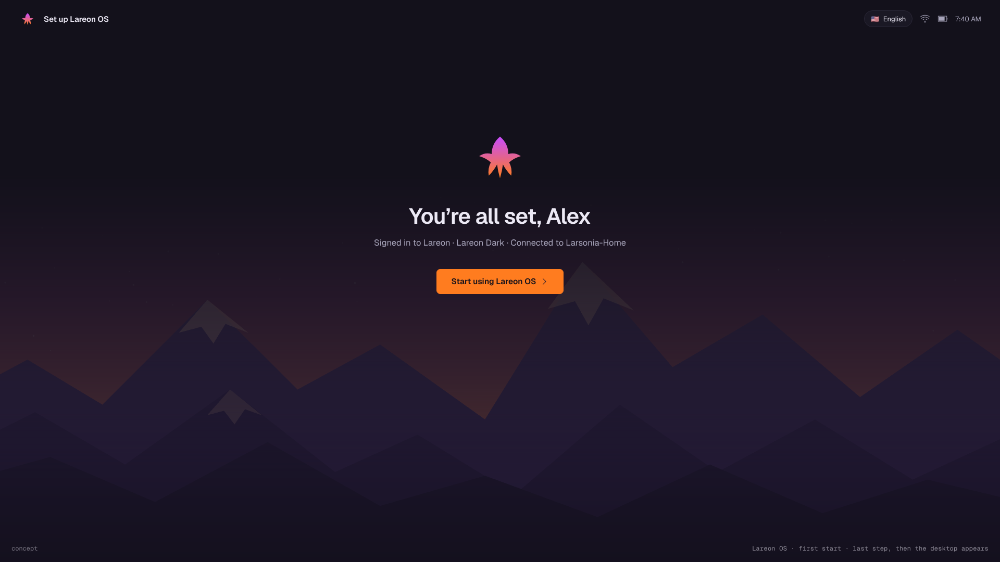

- "You're all set, Alex" with a one-line summary of what was chosen.
- **Start using Lareon OS** opens the desktop for the first time.

---

## How it gets built (summary of roadmap stage 2)

| Part | How | Size |
|---|---|---|
| Boot menu with Install as default | live-build boot menu settings and a GRUB theme | S |
| Installer-only session | live system signs in to a session whose only program is the installer, full screen | S–M |
| Three-step installer | Calamares in OEM mode, Lareon-styled QML pages | M |
| First-start setup | one small custom app (or a restyled KDE Plasma Setup, if it's ready) that creates the first user, then removes itself | M–L |

Must work if something goes wrong: if setup is interrupted (power cut, crash),
it opens again at the next start, so the computer is never left without an account.
